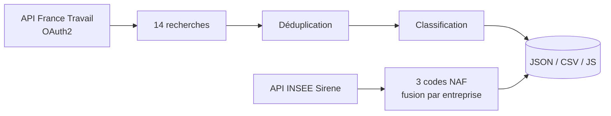

# 📡 Pipeline de veille du marché de l'emploi data


Pipeline qui collecte chaque semaine les offres d'emploi data et les entreprises qui recrutent, à partir de deux APIs publiques. Il déduplique, classe par famille de métiers, et écrit des fichiers exploitables. **Aucune dépendance externe, la bibliothèque standard suffit.**

---

## 📖 Contexte

Je suis en reconversion vers la data et je consultais cinq sites d'offres chaque semaine, en refaisant les mêmes recherches et en relisant les mêmes annonces. C'était long et je n'avais aucune vue d'ensemble : impossible de dire si le marché du Data Engineer bougeait plus que celui du Data Analyst, ni où étaient réellement les postes.

J'ai construit ce pipeline pour arrêter de chercher à la main et commencer à mesurer.

---

## 🎯 Ce qu'il fait

- Lance **14 recherches métier** sur l'API France Travail et fusionne les résultats
- **Déduplique** sur l'identifiant d'offre (une même annonce ressort sur plusieurs recherches)
- **Classe** chaque offre dans une famille de métiers à partir de son intitulé
- Détecte les **alternances**, qui ne sont pas toujours signalées par le champ prévu
- Récupère les **entreprises de 50 salariés et plus** sur trois codes NAF via l'INSEE Sirene
- Écrit le tout en **JSON et CSV**, et en `.js` si le résultat doit alimenter une page locale

---

## 🏗️ Architecture



| Module | Rôle |
|---|---|
| `src/config.py` | clés lues depuis `.env`, recherches et codes NAF |
| `src/http_client.py` | appels HTTP, relances avec attente croissante |
| `src/france_travail.py` | OAuth2, recherche, normalisation, classification |
| `src/sirene.py` | recherche d'entreprises, fusion, tri par effectif |
| `src/outputs.py` | écriture JSON, CSV et JS |
| `pipeline.py` | orchestration et rapport d'exécution |

---

## 🔍 Ce que ça donne

Relevé du 8 septembre 2026, sur l'ensemble de la France :

| | |
|---|---|
| Offres collectées | **698**, dont 43 en alternance |
| Entreprises | **1 166** de 50 salariés et plus, en Île-de-France |
| Durée | **11 secondes** |

Répartition par famille de métiers :

| DE | DA | ML | BI | GOUV | DS | AE |
|---|---|---|---|---|---|---|
| 226 | 138 | 92 | 77 | 74 | 68 | 8 |

Une donnée que je n'aurais pas vue en cherchant à la main : les postes de Data Engineer sont **1,6 fois plus nombreux** que ceux de Data Analyst, alors que les seconds sont bien plus visibles dans les formations.

---

## 🧪 Choix techniques

**Aucune dépendance.** Tout tient avec `urllib`, `json`, `csv` et `re`. Rien à installer, rien qui casse à la prochaine mise à jour d'une bibliothèque, et le script tourne sur n'importe quelle machine avec Python.

**Chaque source est isolée.** Si l'API Sirene tombe, les offres sont quand même collectées, et l'inverse est vrai. Une recherche en échec n'interrompt pas les treize autres. Le rapport final liste ce qui n'est pas passé.

**Relances avec attente croissante.** Trois tentatives par appel, sauf sur les codes 400, 401, 403 et 404 : les retenter ne sert à rien, autant échouer tout de suite.

**L'ordre de classification compte.** « Analytics Engineer » est testé avant « Data Engineer », sinon la seconde expression avalerait la première. Même logique pour « Data Scientist » avant « Machine Learning ».

**Les alternances sont détectées sur trois signaux** : le champ `alternance`, la nature du contrat, et l'intitulé. Le champ seul en rate une partie.

**Sortie `.js` en plus du JSON.** Un navigateur bloque `fetch()` sur un fichier ouvert en `file://`. Un fichier `.js` chargé par `<script src>` passe, ce qui permet d'alimenter une page locale sans monter de serveur.

---

## ▶️ Utilisation

```bash
git clone https://github.com/Heltondsm/job-market-pipeline.git
cd job-market-pipeline
cp .env.example .env      # puis renseigner les deux clés
python3 pipeline.py
```

```bash
python3 pipeline.py --offres              # offres seulement
python3 pipeline.py --entreprises         # entreprises seulement
python3 pipeline.py --dept 75 92 93       # départements ciblés
python3 pipeline.py --js                  # écrit aussi les .js
```

### Obtenir les clés

| API | Où | Gratuit |
|---|---|---|
| France Travail Offres v2 | [francetravail.io](https://francetravail.io) | oui |
| INSEE Sirene 3.11 | [portail-api.insee.fr](https://portail-api.insee.fr) | oui |

### Exécution automatique

Sur macOS, avec `launchd`, tous les lundis à 14h :

```xml
<key>StartCalendarInterval</key>
<dict><key>Weekday</key><integer>1</integer><key>Hour</key><integer>14</integer></dict>
```

Sur Linux, en cron : `0 14 * * 1 cd /chemin/job-market-pipeline && python3 pipeline.py`

---

## 📁 Structure

```
job-market-pipeline/
├── pipeline.py          # point d'entrée
├── src/
│   ├── config.py
│   ├── http_client.py
│   ├── france_travail.py
│   ├── sirene.py
│   └── outputs.py
├── data/                # sorties, non versionnées
├── .env.example
└── requirements.txt     # vide, c'est voulu
```
